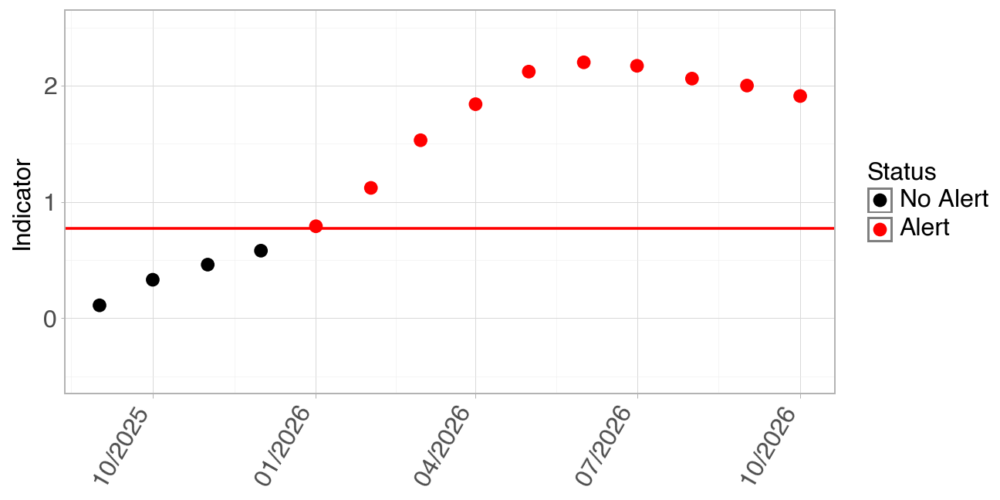

---
pagetitle: "Conservation Area Status"
anchor-sections: false
page-layout: full
jupyter: python3
format:
  html:
    toc: false
    css: ../../css/totaltool-closure-status.css
    include-after-body: ../../js/totaltool-closure-status.html
---

::: {.column-page}

```{python}
#| echo: false
#| output: asis

import yaml
import markdown
from html import escape
from urllib.parse import urlsplit, urlunsplit
from IPython.display import display, HTML

with open("../../content/totaltool-closure-status.yml", encoding="utf-8") as f:
    data = yaml.safe_load(f) or {}

nav = data.get("navigation", {})
hero = data.get("hero", {})
closure = data.get("closure", {})
environment = data.get("environment", {})
enso = environment.get("enso", {})
heatwave = environment.get("heatwave", {})
temperature = environment.get("temperature", {})
total = data.get("total_tool", {})
maps = data.get("maps", {})
disclaimer = data.get("disclaimer", {})


# ==========================================================
# HELPERS
# ==========================================================

def safe(value):
    return escape(str(value if value is not None else ""), quote=True)


def md(value):
    return markdown.markdown(
        str(value or ""),
        extensions=["tables", "sane_lists"]
    )


def page_url(value):
    parts = urlsplit(str(value or ""))
    if parts.path.endswith(".qmd"):
        parts = parts._replace(path=parts.path[:-4] + ".html")
    return urlunsplit(parts)


def external_link(url, label):
    if not url:
        return ""
    return f"""
    <a href="{safe(url)}" target="_blank" rel="noopener noreferrer">
      {safe(label)}
    </a>
    """


def heading(title, eyebrow=""):
    eyebrow_html = (
        f'<span class="cw-totaltool-status-kicker">{safe(eyebrow)}</span>'
        if eyebrow else ""
    )
    return f"""
    <div class="cw-totaltool-status-heading">
      {eyebrow_html}
      <h2>{safe(title)}</h2>
    </div>
    """


# ==========================================================
# NAVIGATION
# ==========================================================

nav_links = ""

for link in nav.get("links", []):
    url = page_url(link.get("url"))
    active = (
        urlsplit(url).path.rsplit("/", 1)[-1]
        == "totaltool-closure-status.html"
    )

    nav_links += f"""
    <a class="cw-totaltool-status-tab{' is-active' if active else ''}"
       href="{safe(url)}"
       {'aria-current="page"' if active else ''}>
      {safe(link.get('label'))}
    </a>
    """


# ==========================================================
# REGULATORY CLOSURE STATUS
# ==========================================================

closure_state = str(closure.get("state", "unknown")).lower()

if closure_state not in ("active", "inactive", "unknown"):
    closure_state = "unknown"

closure_labels = {
    "active": "Closure in effect",
    "inactive": "No Closure in Effect",
    "unknown": "Closure status not verified"
}

closure_label = (
    closure.get("status_text")
    or closure_labels[closure_state]
)


# ==========================================================
# PAGE HTML
# ==========================================================

html = f"""
<div class="cw-totaltool-status">

  <!-- NAVIGATION -->

  <header class="cw-totaltool-status-topbar">

    <a class="cw-totaltool-status-brand" href="totaltool.html">
      <strong>{safe(nav.get('brand', 'TOTAL'))}</strong>
      <span>{safe(nav.get('brand_subtitle'))}</span>
    </a>

    <nav class="cw-totaltool-status-tabs"
         aria-label="TOTAL navigation">
      {nav_links}
    </nav>

  </header>


  <!-- HERO -->

  <section class="cw-totaltool-status-hero">

    <span class="cw-totaltool-status-hero-eyebrow">
      {safe(hero.get('eyebrow'))}
    </span>

    <h1>{safe(hero.get('title'))}</h1>

    <p>{safe(hero.get('subtitle'))}</p>

  </section>


  <!-- ====================================================
       REGULATORY CLOSURE STATUS
       ==================================================== -->

  <section class="cw-totaltool-status-section">

    {heading(closure.get('title'), closure.get('eyebrow'))}

    <div class="cw-totaltool-status-closure is-{safe(closure_state)}">

      <div class="cw-totaltool-status-closure-header">

        <div class="cw-totaltool-status-closure-header-text">

          <span class="cw-totaltool-status-small-label">
            OFFICIAL REGULATORY STATUS
          </span>

          <h3 id="closure-status">
            {safe(closure_label)}
          </h3>

        </div>

        <span class="cw-totaltool-status-status-icon"
              aria-hidden="true"></span>

      </div>


      <div class="cw-totaltool-status-closure-body">

        <div class="cw-totaltool-status-closure-description">
          {md(closure.get('description'))}
        </div>

        <div class="cw-totaltool-status-closure-meta">

          <div class="cw-totaltool-status-date-item">
            <span>Updated</span>
            <strong id="closure-today">Loading...</strong>
          </div>

          <div class="cw-totaltool-status-date-item">
            <span>Last closure ended</span>
            <strong>
              {safe(closure.get('last_closure', 'Not available'))}
            </strong>
          </div>

        </div>

        <div class="cw-totaltool-status-closure-source">
          {external_link(
              closure.get('source_url'),
              closure.get('source_label')
          )}
        </div>

      </div>

    </div>

  </section>


  <!-- ====================================================
       ENVIRONMENTAL CONDITIONS
       ==================================================== -->

  <section class="cw-totaltool-status-section">

    {heading(environment.get('title'), environment.get('eyebrow'))}

    <p class="cw-totaltool-status-section-intro">
      {safe(environment.get('introduction'))}
    </p>

    <div class="cw-totaltool-status-environment-grid">

      <!-- LEFT COLUMN: ENSO AND MARINE HEATWAVE -->

      <div class="cw-totaltool-status-climate-column">

        <!-- EL NIÑO -->

        <article class="cw-totaltool-status-card">

          <span class="cw-totaltool-status-card-label">
            CLIMATE CONDITIONS
          </span>

          <h3>{safe(enso.get('title'))}</h3>

          <div class="cw-totaltool-status-dynamic-value"
               id="nino-status">
            Loading...
          </div>

          <p class="cw-totaltool-status-updated">
            <strong>Updated:</strong>
            <span id="nino-date">Loading...</span>
          </p>

          <h4>
            {safe(enso.get('forecast_label', 'Forecast'))}
          </h4>

          <p id="nino-synopsis">
            Loading ENSO synopsis...
          </p>

          <div class="cw-totaltool-status-source">
            <a id="nino-link"
               href="{safe(enso.get('source_url'))}"
               target="_blank"
               rel="noopener noreferrer">
              {safe(enso.get('source_label'))}
            </a>
          </div>

        </article>


        <!-- MARINE HEATWAVE -->

        <article class="cw-totaltool-status-card">

          <span class="cw-totaltool-status-card-label">
            OCEAN CONDITIONS
          </span>

          <h3>{safe(heatwave.get('title'))}</h3>

          <p>
            <strong>Forecast period:</strong>
            <span id="heat-period">Loading...</span>
          </p>

          <p class="cw-totaltool-status-updated"
             id="heat-date">
            Loading...
          </p>

          <div id="heat-regions"
               class="cw-totaltool-status-heat-regions"
               aria-live="polite">
            Loading marine heatwave forecast...
          </div>

          <div class="cw-totaltool-status-source">
            <a id="heat-link"
               href="{safe(heatwave.get('source_url'))}"
               target="_blank"
               rel="noopener noreferrer">
              {safe(heatwave.get('source_label'))}
            </a>
          </div>

        </article>

      </div>


      <!-- RIGHT COLUMN: SEA TEMPERATURE -->

      <article class="cw-totaltool-status-temperature">

        <span class="cw-totaltool-status-card-label">
          MONTHLY OBSERVATIONS
        </span>

        <div class="cw-totaltool-status-temperature-heading">

          <h3>{safe(temperature.get('title'))}</h3>

          <fieldset class="cw-totaltool-status-unit-toggle">

            <legend>Temperature units</legend>

            <label>
              <input type="radio"
                     name="temp-unit"
                     value="C"
                     checked>
              °C
            </label>

            <label>
              <input type="radio"
                     name="temp-unit"
                     value="F">
              °F
            </label>

          </fieldset>

        </div>


        <!-- DYNAMIC SST TABLE -->

        <div class="cw-totaltool-status-table-scroll"
             id="sst-table-container">
          <p>Loading temperature data...</p>
        </div>


        <!-- DESCRIPTION AND SOURCE -->

        <p class="cw-totaltool-status-temperature-description">
          {safe(temperature.get('description'))}
        </p>

        <div class="cw-totaltool-status-source">
          {external_link(
              temperature.get('source_url'),
              temperature.get('source_label')
          )}
        </div>


        <!-- CONSERVATION AREA MAP -->

        <figure class="cw-totaltool-status-area-map">

          

          <figcaption>
            {safe(temperature.get('image_caption'))}
          </figcaption>

        </figure>

      </article>

    </div>

  </section>


  <!-- ====================================================
       TOTAL BYCATCH AVOIDANCE TOOL
       ==================================================== -->

  <section class="cw-totaltool-status-section">

    {heading(total.get('title'), total.get('eyebrow'))}

    <div class="cw-totaltool-status-total-panel">

      <div class="cw-totaltool-status-panel-heading">

        <span class="cw-totaltool-status-card-label">
          TOTAL INDICATOR
        </span>

        <h3>TOTAL Time Series</h3>

      </div>


      <!-- DYNAMIC SUMMARY METRICS -->

      <div class="cw-totaltool-status-metrics">

        <div class="cw-totaltool-status-metric">
          <span>Most recent forecast</span>
          <strong id="total-fcdate">Loading...</strong>
        </div>

        <div class="cw-totaltool-status-metric">
          <span>Indicator value</span>
          <strong id="total-index">Loading...</strong>
        </div>

        <div class="cw-totaltool-status-metric">
          <span>Indicator alert</span>
          <strong id="total-status">Loading...</strong>
        </div>

      </div>


      <p class="cw-totaltool-status-updated
                cw-totaltool-status-total-updated">
        <strong>Data updated:</strong>
        <span id="total-updated">Loading...</span>
      </p>


      <!-- EXPLANATORY TEXT -->

      <div class="cw-totaltool-status-total-description">
        {md(total.get('description'))}
      </div>


      <!-- AUTOMATICALLY GENERATED INDICATOR PLOT -->

      <figure class="cw-totaltool-status-indicator-figure">

        

        <figcaption>
          {safe(total.get('image_caption'))}
        </figcaption>

      </figure>


      <!-- THRESHOLD AND HISTORICAL DATA -->

      <div class="cw-totaltool-status-total-footer">

        <div class="cw-totaltool-status-threshold-note">

          <strong>
            Indicator threshold: {safe(total.get('threshold'))}
          </strong>

          <span>{safe(total.get('threshold_note'))}</span>

        </div>

        <a class="cw-totaltool-status-download"
           href="data/resources/loggerhead_indx.csv"
           download>
          {safe(total.get('download_label'))}
        </a>

      </div>

    </div>

  </section>


  <!-- ====================================================
       MONTHLY SEA SURFACE MAPS
       ==================================================== -->

  <section class="cw-totaltool-status-section">

    {heading(maps.get('title'), maps.get('eyebrow'))}

    <p class="cw-totaltool-status-section-intro">
      {safe(maps.get('introduction'))}
    </p>

    <div class="cw-totaltool-status-map-grid">


      <!-- SST MAP -->

      <article class="cw-totaltool-status-map-card">

        <span class="cw-totaltool-status-card-label">
          SATELLITE OBSERVATIONS
        </span>

        <h3>{safe(maps.get('sst_title'))}</h3>

        <div class="cw-totaltool-status-map-controls">

          <button type="button"
                  id="sst-prev"
                  aria-label="Previous SST month">
            ‹ Previous
          </button>

          <strong id="sst-month-label">Loading...</strong>

          <button type="button"
                  id="sst-next"
                  aria-label="Next SST month">
            Next ›
          </button>

        </div>

        <div class="cw-totaltool-status-map-image">

          

          <p id="sst-empty" hidden>
            No monthly maps available.
          </p>

        </div>

        <p>{safe(maps.get('sst_description'))}</p>

        <div class="cw-totaltool-status-source">
          {external_link(
              maps.get('sst_source_url'),
              maps.get('source_label', 'GHRSST MUR dataset')
          )}
        </div>

      </article>


      <!-- SST ANOMALY MAP -->

      <article class="cw-totaltool-status-map-card">

        <span class="cw-totaltool-status-card-label">
          SATELLITE OBSERVATIONS
        </span>

        <h3>{safe(maps.get('anomaly_title'))}</h3>

        <div class="cw-totaltool-status-map-controls">

          <button type="button"
                  id="anom-prev"
                  aria-label="Previous anomaly month">
            ‹ Previous
          </button>

          <strong id="anom-month-label">Loading...</strong>

          <button type="button"
                  id="anom-next"
                  aria-label="Next anomaly month">
            Next ›
          </button>

        </div>

        <div class="cw-totaltool-status-map-image">

          

          <p id="anom-empty" hidden>
            No monthly maps available.
          </p>

        </div>

        <p>{safe(maps.get('anomaly_description'))}</p>

        <div class="cw-totaltool-status-source">
          {external_link(
              maps.get('anomaly_source_url'),
              maps.get('source_label', 'GHRSST MUR dataset')
          )}
        </div>

      </article>

    </div>

  </section>


  <!-- ====================================================
       DISCLAIMER
       ==================================================== -->

  <section class="cw-totaltool-status-disclaimer">
    {md(disclaimer.get('text'))}
  </section>

</div>
"""

display(HTML(html))
```

:::
