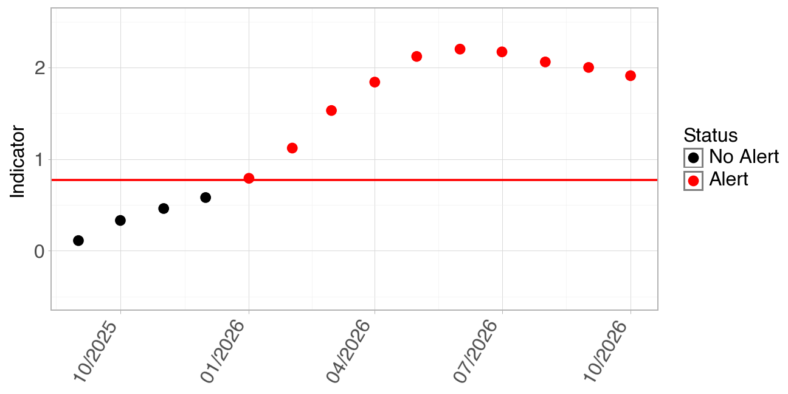

---
pagetitle: "Data Dashboard"
anchor-sections: false
page-layout: full
jupyter: python3
format:
  html:
    toc: false
    css: ../../css/totaltool-data-dashboard.css
    include-after-body: ../../js/totaltool-data-dashboard.html
---

```{python}
#| echo: false
#| output: asis

import json
import yaml
import markdown
from datetime import datetime
from html import escape
from urllib.parse import urlsplit, urlunsplit
from IPython.display import display, HTML


# ==========================================================
# LOAD PAGES CMS CONTENT
# ==========================================================

with open(
    "../../content/totaltool-data-dashboard.yml",
    encoding="utf-8"
) as f:
    data = yaml.safe_load(f) or {}

with open(
    "../../content/totaltool-environmental-history.yml",
    encoding="utf-8"
) as f:
    history = yaml.safe_load(f) or {}

nav = data.get("navigation", {})
hero = data.get("hero", {})
intro = data.get("introduction", {})
closure = data.get("closure", {})
environment = data.get("environment", {})
bycatch = data.get("bycatch", {})
maps = data.get("maps", {})
disclaimer = data.get("disclaimer", {})

historical_records = history.get("environmental_conditions", [])

if not isinstance(historical_records, list):
    historical_records = []


# ==========================================================
# HELPERS
# ==========================================================

def safe(value):
    return escape(
        str(value if value is not None else ""),
        quote=True
    )


def md(value):
    return markdown.markdown(
        str(value or ""),
        extensions=["tables", "sane_lists"]
    )


def page_url(value):
    parts = urlsplit(str(value or ""))

    if parts.path.endswith(".qmd"):
        parts = parts._replace(
            path=parts.path[:-4] + ".html"
        )

    return urlunsplit(parts)


def external_link(url, label):
    if not url:
        return ""

    return f"""
    <a href="{safe(url)}"
       target="_blank"
       rel="noopener noreferrer">
      {safe(label)}
    </a>
    """


def heading(title, eyebrow=""):
    eyebrow_html = (
        f'<span class="cw-totaltool-dash-kicker">'
        f'{safe(eyebrow)}</span>'
        if eyebrow else ""
    )

    return f"""
    <div class="cw-totaltool-dash-heading">
      {eyebrow_html}
      <h2>{safe(title)}</h2>
    </div>
    """


def json_for_script(value):
    return (
        json.dumps(
            value,
            ensure_ascii=False,
            default=str
        )
        .replace("<", "\\u003c")
        .replace(">", "\\u003e")
        .replace("&", "\\u0026")
    )


# ==========================================================
# HISTORICAL YEAR SELECTOR
# ==========================================================

historical_years = set()

for record in historical_records:
    if not isinstance(record, dict):
        continue

    try:
        historical_years.add(int(record.get("year")))
    except (ValueError, TypeError):
        pass

# Only include completed calendar years
latest_year = datetime.now().year - 1

# Historical records begin in 2003
start_year = min(historical_years, default=2003)

year_options = ""

for year in range(latest_year, start_year - 1, -1):
    selected = " selected" if year == latest_year else ""

    year_options += f"""
    <option value="{year}"{selected}>
      {year}
    </option>
    """


# ==========================================================
# NAVIGATION
# ==========================================================

nav_links = ""

for link in nav.get("links", []):
    url = page_url(link.get("url"))

    active = (
        urlsplit(url).path.rsplit("/", 1)[-1]
        == "totaltool-data-dashboard.html"
    )

    nav_links += f"""
    <a class="cw-totaltool-dash-tab{' is-active' if active else ''}"
       href="{safe(url)}"
       {'aria-current="page"' if active else ''}>
      {safe(link.get('label'))}
    </a>
    """


# ==========================================================
# DASHBOARD CONTENT
# ==========================================================

environment_table = environment.get("table", {}) or {}
sst_map = maps.get("sst", {}) or {}
anomaly_map = maps.get("anomaly", {}) or {}

html = f"""
<div class="cw-totaltool-dash">

  <!-- NAVIGATION -->

  <header class="cw-totaltool-dash-topbar">

    <a class="cw-totaltool-dash-brand"
       href="totaltool.html">
      <strong>{safe(nav.get('brand', 'TOTAL'))}</strong>
      <span>{safe(nav.get('brand_subtitle'))}</span>
    </a>

    <nav class="cw-totaltool-dash-tabs"
         aria-label="TOTAL navigation">
      {nav_links}
    </nav>

  </header>


  <!-- HERO -->

  <section class="cw-totaltool-dash-hero">

    <span class="cw-totaltool-dash-hero-eyebrow">
      {safe(hero.get('eyebrow', 'HISTORICAL OBSERVATIONS'))}
    </span>

    <h1>{safe(hero.get('title', 'Data Dashboard'))}</h1>

    <p>{safe(hero.get('subtitle'))}</p>

  </section>


  <!-- INTRODUCTION AND YEAR SELECTOR -->

  <section class="cw-totaltool-dash-section">

    <div class="cw-totaltool-dash-intro-layout">

      <div class="cw-totaltool-dash-intro-text">

        {heading(
            intro.get('title', 'Explore Historical Data'),
            intro.get('eyebrow', 'DATA EXPLORER')
        )}

        <div class="cw-totaltool-dash-section-intro">
          {md(intro.get('description'))}
        </div>

      </div>

      <div class="cw-totaltool-dash-year-panel">

        <label for="year-select-input">
          {safe(intro.get('year_label', 'Select Year'))}
        </label>

        <select id="year-select-input">
          {year_options}
        </select>

        <span class="cw-totaltool-dash-year-hint">
          View historical observations
        </span>

      </div>

    </div>

  </section>


  <!-- CONSERVATION AREA CLOSURE HISTORY -->

  <section class="cw-totaltool-dash-section">

    {heading(
        closure.get('title', 'Conservation Area Closure History'),
        closure.get('eyebrow', 'FISHERY MANAGEMENT')
    )}

    <article class="cw-totaltool-dash-card
                    cw-totaltool-dash-closure-card">

      <span class="cw-totaltool-dash-card-label">
        HISTORICAL CLOSURE INFORMATION
      </span>

      <h3>
        {safe(closure.get('subtitle', 'Closure Status'))}
        <span id="closure-year">{latest_year}</span>
        {safe(closure.get('season_suffix', 'Season'))}
      </h3>

      <div id="closure-text"
           class="cw-totaltool-dash-closure-text"
           aria-live="polite">
        Loading closure history...
      </div>

      <div class="cw-totaltool-dash-source">
        {external_link(
            closure.get('source_url'),
            closure.get('source_label')
        )}
      </div>

    </article>

  </section>


  <!-- ENVIRONMENTAL CONDITIONS -->

  <section class="cw-totaltool-dash-section">

    {heading(
        environment.get('title', 'Environmental Conditions'),
        environment.get('eyebrow', 'OCEAN MONITORING')
    )}

    <article class="cw-totaltool-dash-card
                    cw-totaltool-dash-environment-card">

      <span class="cw-totaltool-dash-card-label">
        HISTORICAL ENVIRONMENTAL CONDITIONS
      </span>

      <div class="cw-totaltool-dash-card-heading">

        <h3>
          {safe(environment.get('subtitle', 'Environmental Conditions'))}
          <span id="elnino-year">{latest_year}</span>
          {safe(environment.get('season_suffix', 'Season'))}
        </h3>

        <fieldset class="cw-totaltool-dash-unit-toggle">

          <legend>Temperature units</legend>

          <label>
            <input type="radio"
                   name="unit"
                   value="C"
                   checked>
            °C
          </label>

          <label>
            <input type="radio"
                   name="unit"
                   value="F">
            °F
          </label>

        </fieldset>

      </div>

      <div class="cw-totaltool-dash-table-scroll">

        <table id="elnino-table"
               class="cw-totaltool-dash-table">

          <thead>
            <tr>
              <th>
                {safe(environment_table.get('month', 'Month'))}
              </th>
              <th>
                {safe(environment_table.get('status', 'El Niño Status'))}
              </th>
              <th>
                {safe(environment_table.get('forecast', 'El Niño Forecast'))}
              </th>
              <th id="temp-header">SST (°C)</th>
              <th id="anom-header">Anomaly (°C)</th>
            </tr>
          </thead>

          <tbody>
            <tr>
              <td colspan="5">
                Loading environmental data...
              </td>
            </tr>
          </tbody>

        </table>

      </div>

      <div class="cw-totaltool-dash-source">
        {external_link(
            environment.get('source_url'),
            environment.get('source_label')
        )}
      </div>

    </article>

  </section>


  <!-- HISTORICAL TOTAL INDICATOR -->

  <section class="cw-totaltool-dash-section">

    {heading(
        bycatch.get('title', 'TOTAL Bycatch Avoidance Indicator'),
        bycatch.get('eyebrow', 'BYCATCH AVOIDANCE')
    )}

    <article class="cw-totaltool-dash-total-panel">

      <span class="cw-totaltool-dash-card-label">
        TOTAL INDICATOR
      </span>

      <h3>
        {safe(bycatch.get('subtitle', 'TOTAL Time Series'))}
        <span id="bycatch-year">{latest_year}</span>
      </h3>

      <div class="cw-totaltool-dash-period-panel">

        <span>Observation period</span>

        <strong id="bycatch-range">
          January – December {latest_year}
        </strong>

      </div>

      <div class="cw-totaltool-dash-total-description">
        {md(bycatch.get('description'))}
      </div>

      <figure class="cw-totaltool-dash-indicator-figure">

        

        <p id="bycatch-empty"
           class="cw-totaltool-dash-empty"
           hidden>
          {safe(bycatch.get('missing_image', 'No indicator image available.'))}
        </p>

      </figure>

    </article>

  </section>


  <!-- MONTHLY SEA SURFACE MAPS -->

  <section class="cw-totaltool-dash-section">

    {heading(
        maps.get('title', 'Monthly Sea Surface Maps'),
        maps.get('eyebrow', 'SATELLITE OBSERVATIONS')
    )}

    <div class="cw-totaltool-dash-map-grid">

      <!-- SEA SURFACE TEMPERATURE -->

      <article class="cw-totaltool-dash-map-card">

        <span class="cw-totaltool-dash-card-label">
          SATELLITE OBSERVATIONS
        </span>

        <h3>
          {safe(sst_map.get('title', maps.get('sst_title', 'Sea Surface Temperature')))}
          <span id="sst-year">{latest_year}</span>
        </h3>

        <div class="sst-dash-slider
                    cw-totaltool-dash-map-controls">

          <button class="prev"
                  type="button"
                  aria-label="Previous SST month">
            ‹ Previous
          </button>

          <strong id="sst-caption">
            Loading...
          </strong>

          <button class="next"
                  type="button"
                  aria-label="Next SST month">
            Next ›
          </button>

        </div>

        <div class="cw-totaltool-dash-map-image">

          

          <p id="sst-empty"
             class="cw-totaltool-dash-empty"
             hidden>
            {safe(maps.get('missing_image', 'No monthly map available.'))}
          </p>

        </div>

        <div class="cw-totaltool-dash-map-description">
          {md(sst_map.get('description', maps.get('sst_description')))}
        </div>

        <div class="cw-totaltool-dash-source">
          {external_link(
              sst_map.get('source_url', maps.get('sst_source_url')),
              maps.get('source_label', 'Dataset: GHRSST MUR')
          )}
        </div>

      </article>


      <!-- SEA SURFACE TEMPERATURE ANOMALY -->

      <article class="cw-totaltool-dash-map-card">

        <span class="cw-totaltool-dash-card-label">
          SATELLITE OBSERVATIONS
        </span>

        <h3>
          {safe(anomaly_map.get('title', maps.get('anomaly_title', 'Sea Surface Temperature Anomaly')))}
          <span id="anom-year">{latest_year}</span>
        </h3>

        <div class="anom-dash-slider
                    cw-totaltool-dash-map-controls">

          <button class="prev"
                  type="button"
                  aria-label="Previous anomaly month">
            ‹ Previous
          </button>

          <strong id="anom-caption">
            Loading...
          </strong>

          <button class="next"
                  type="button"
                  aria-label="Next anomaly month">
            Next ›
          </button>

        </div>

        <div class="cw-totaltool-dash-map-image">

          

          <p id="anom-empty"
             class="cw-totaltool-dash-empty"
             hidden>
            {safe(maps.get('missing_image', 'No monthly map available.'))}
          </p>

        </div>

        <div class="cw-totaltool-dash-map-description">
          {md(anomaly_map.get('description', maps.get('anomaly_description')))}
        </div>

        <div class="cw-totaltool-dash-source">
          {external_link(
              anomaly_map.get('source_url', maps.get('anomaly_source_url')),
              maps.get('source_label', 'Dataset: GHRSST MUR')
          )}
        </div>

      </article>

    </div>

  </section>


  <!-- DISCLAIMER -->

  <section class="cw-totaltool-dash-disclaimer">
    {md(disclaimer.get('text'))}
  </section>

</div>


<!-- ======================================================
     EMBEDDED DATA FOR JAVASCRIPT
     ====================================================== -->

<!-- Historical environmental records -->
<script type="application/json"
        id="historical-environment-data">
{json_for_script(historical_records)}
</script>

<!-- Pages CMS dashboard content -->
<script type="application/json"
        id="dashboard-content-data">
{json_for_script(data)}
</script>

"""

display(HTML(html))
```